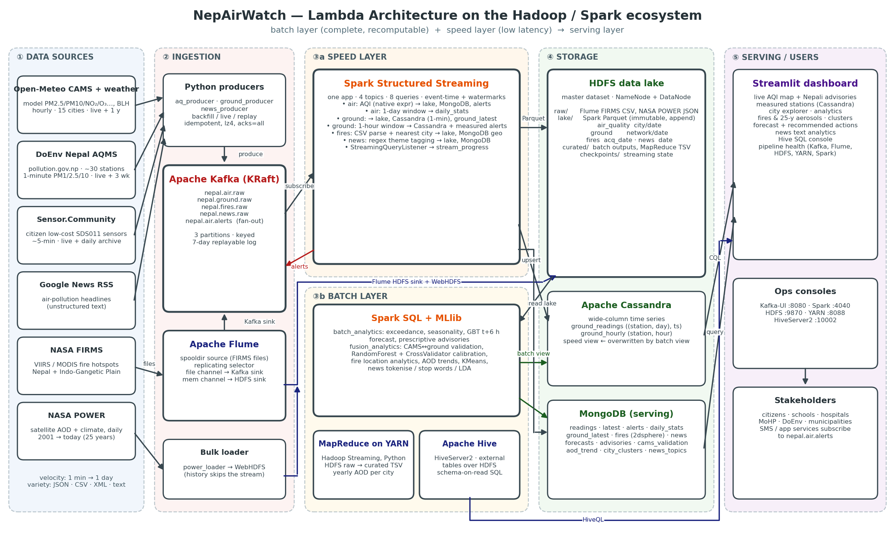

# NepAirWatch — Real-time Air Quality Monitoring & Early Warning for Nepal

A big-data platform built as a **Lambda architecture** on the Hadoop / Spark ecosystem. It covers HDFS,
YARN + MapReduce, Hive, Flume, Kafka, Spark (Structured Streaming, SQL, MLlib), Cassandra and MongoDB.
It ingests **six historical and live data sources** for Nepal: modelled air quality and weather for 15 cities,
1-minute measurements from the Government of Nepal's monitoring stations, citizen low-cost sensors, NASA
satellite fire hotspots, 25 years of NASA satellite aerosol data, and news headlines. From these it
computes AQI and health alerts in real time, validates and calibrates the air-quality model against
ground truth, measures exposure against Nepal's national standard and the WHO guideline, forecasts PM2.5
six hours ahead, and recommends actions to schools, hospitals and municipalities.



## 1. Problem

Every winter, Kathmandu Valley and the Terai rank among the most polluted places in the world. PM2.5 often
exceeds Nepal's National Ambient Air Quality Standard (40 µg/m³, 24 h) and is several times the WHO 2021
guideline (15 µg/m³). The causes are brick kilns, vehicle exhaust, open burning, forest fires, cross-border
haze from the Indo-Gangetic Plain, and the valley's bowl shape. Air pollution is one of the leading risk
factors for death in Nepal. Yet:

* Ground monitoring stations are few, mostly in the Kathmandu Valley, and frequently offline.
* Data is published as raw numbers without health advice in Nepali.
* Nothing warns citizens, schools or hospitals **before** a pollution episode.
* Historical data is not aggregated to show *where* and *when* standards are breached, which is the
  evidence policy-makers need.

**NepAirWatch** gives continuous nationwide coverage with streaming ingestion, real-time AQI and alerts,
bilingual advisories, historical analytics and an ML early-warning forecast.

## 2. Data sources

| # | Source | Type | What | Historical | Live | Ingestion path |
| --- | --- | --- | --- | --- | --- | --- |
| 1 | **Open-Meteo Air-Quality + Weather API** (Copernicus CAMS model) | model, JSON | PM2.5, PM10, CO, NO₂, SO₂, O₃, dust, temperature, humidity, wind, rain, boundary-layer height; 15 cities, hourly | 365 days (`BACKFILL_DAYS`) | every 15 min | producer → Kafka `nepal.air.raw` |
| 2 | **DoEnv Nepal AQMS** (`pollution.gov.np/gss/api`) | measured, JSON | ~30 reference stations in all 7 provinces (Ratnapark, Pulchowk, US Embassy, Biratnagar, …): PM1 / PM2.5 / PM10 every **minute** | ~3 weeks (the API keeps a rolling window, so our lake becomes the long-term archive) | every 10 min | producer → Kafka `nepal.ground.raw` |
| 3 | **Sensor.Community** citizen sensors (SDS011) | measured, JSON + CSV | low-cost PM2.5 / PM10 sensors in Kathmandu and Madhesh, ~5-min | daily archive CSVs | every 10 min | producer → Kafka `nepal.ground.raw` |
| 4 | **NASA FIRMS** active fires (VIIRS S-NPP / NOAA-20 / NOAA-21, MODIS) | satellite, CSV | fire hotspots (forest fires, crop-residue burning) over Nepal + the Indo-Gangetic Plain | 7 days, or any period with a free `FIRMS_MAP_KEY` | every 3 h | fetcher → **Flume** spooldir → Kafka `nepal.fires.raw` + HDFS raw zone |
| 5 | **NASA POWER** (CERES SYN1deg + MERRA-2) | satellite / reanalysis, JSON | daily aerosol optical depth (AOD 550 nm), temperature, humidity, wind, precipitation per city | **2001 → today (25 years)** | — (batch) | bulk loader → WebHDFS → HDFS raw zone |
| 6 | **Google News RSS** | unstructured text, XML | headlines about air pollution, haze, forest fires and brick kilns in Nepal | latest ~100 per query | every 30 min | producer → Kafka `nepal.news.raw` |

All sources are free. Only FIRMS history beyond 7 days needs a (free) key. Volume after the first start is
about 132,000 hourly model records, ~700,000 one-minute ground readings (growing by ~45,000 a day),
~137,000 NASA POWER city-days, and thousands of fire hotspots. The design scales horizontally through more
Kafka partitions, Spark executors and DataNodes.

## 3. Big-data components

| Layer | Component | Role |
| --- | --- | --- |
| Ingestion | **Apache Kafka 3.8** (KRaft, no ZooKeeper) | 5 topics, keyed partitions, replayable log, alert fan-out (`nepal.air.alerts`) |
| Ingestion | **Apache Flume 1.11** | Spooling-directory source → replicating selector → file channel → Kafka sink, memory channel → HDFS sink |
| Storage | **HDFS 3.4** (NameNode + DataNode) | Data lake / master dataset: `raw/`, `lake/`, `curated/`, streaming checkpoints |
| Storage | **Apache Cassandra 5** | Write-optimised time-series store for 1-minute ground readings, partition key `(station, day)` |
| Storage | **MongoDB 7** | Serving layer for the dashboard; geospatial queries on fire hotspots (2dsphere) |
| Processing (speed) | **Spark 3.5 Structured Streaming** | 4 topics, 8 queries, event-time windows + watermarks, AQI as native expressions |
| Processing (batch) | **Spark SQL + MLlib** | Descriptive, diagnostic, predictive and prescriptive analytics; GBT forecast, RandomForest + CrossValidator calibration, KMeans, LDA |
| Processing (batch) | **Hadoop MapReduce on YARN** (Hadoop Streaming, Python mapper/reducer) | Yearly AOD statistics per city from 25 years of NASA POWER data (`mapreduce/`) |
| Query | **Apache Hive 4** (HiveServer2) | External tables (schema-on-read) over Parquet, CSV, JSON and MapReduce TSV in HDFS; dashboard SQL console |
| Presentation | Streamlit + Plotly, Kafka-UI, HDFS / YARN / Spark / Hive UIs | Dashboard and ops consoles |

**Lambda architecture.** The HDFS lake is the immutable master dataset. The speed layer (Spark Structured
Streaming) writes low-latency views to Cassandra and MongoDB. The batch layer (Spark batch, MapReduce, Hive)
recomputes complete views from the lake and overwrites the speed views under the same key: for example,
`ground_hourly` rows carry `layer = speed | batch`.

**Polyglot persistence.** Each store holds the data it handles best: Cassandra for high-velocity time series
queried by key, MongoDB for flexible documents and geospatial lookups, and Hive for ad-hoc SQL scans over the
whole lake.

## 4. Project layout

```text
common/            config (cities, topics, paths), AQI + advisories + recommended actions, geo, storage (WebHDFS)
producer/          aq_producer.py (Open-Meteo) · ground_producer.py (DoEnv + Sensor.Community)
                   firms_fetcher.py (NASA FIRMS → Flume) · news_producer.py (RSS) · power_loader.py (NASA POWER → HDFS)
spark_jobs/        stream_processor.py — speed layer (8 streaming queries)
                   batch_analytics.py  — CAMS analytics, GBT forecast, prescriptive advisories
                   fusion_analytics.py — ground validation + calibration, fires, AOD trends, KMeans, news LDA
mapreduce/         aod_mapper.py, aod_reducer.py, run_aod_job.sh — Hadoop Streaming job on YARN
hive/              init.hql (external tables) · queries.hql (example HiveQL, also used by the dashboard)
cassandra/         schema.cql
flume/             flume.conf
dashboard/         app.py (Streamlit, 9 tabs) · sources.py (Cassandra / Hive / YARN / Flume clients)
docker/            hadoop/ (Hadoop 3.4 + Flume image, configs) · container entry scripts
scripts/           local-mode scripts, wait_for_lake.py, hive_refresh.py, report/deck/diagram generators
docker-compose.yml the whole platform
```

## 5. Implementation guide

**Prerequisites:** Docker with Compose v2, internet access. RAM: about **8 GB** for the default stack and
**11–12 GB** with `--profile full`. No Python, Java or Hadoop is needed on the host.

```bash
docker compose up -d --build                   # core: Kafka, Flume, HDFS, Cassandra, MongoDB, Spark, dashboard
docker compose --profile full up -d --build    # + YARN/MapReduce and Hive   (or --profile mapreduce / --profile hive)
```

The first build downloads Hadoop and Flume (~1 GB, about 5–8 min). On the first start the containers:

1. start Kafka (KRaft), Kafka-UI, MongoDB, Cassandra, HDFS (NameNode + DataNode); create the topics,
   the Cassandra keyspace and the HDFS directories
2. back-fill history: 365 days of Open-Meteo (`backfill`), ~3 weeks of 1-minute DoEnv + Sensor.Community data
   (`producer-ground`), 7 days of FIRMS fires through Flume (`producer-fires`), news headlines
   (`producer-news`), and 25 years of NASA POWER directly into HDFS (`power-loader`)
3. stream everything Kafka → Spark → HDFS lake + Cassandra + MongoDB + alerts (`spark-streaming`)
4. run the Spark batch layer when the lake is ready and then every 6 h (`spark-batch`): `batch_analytics`
   → `fusion_analytics` → Hive partition refresh
5. keep polling all live sources; with `--profile full` also run the MapReduce job on YARN (`mapreduce`)
   and create the Hive tables (`hive-init`)

| URL | What |
| --- | --- |
| <http://localhost:8501> | NepAirWatch dashboard |
| <http://localhost:8080> | Kafka-UI (topics, partitions, messages) |
| <http://localhost:4040> | Spark UI of the streaming job |
| <http://localhost:9870> | HDFS NameNode UI (browse `/nepairwatch`) |
| <http://localhost:8088> | YARN ResourceManager (MapReduce jobs) — profile `mapreduce` / `full` |
| <http://localhost:10002> | HiveServer2 UI — profile `hive` / `full` |

```bash
docker compose ps                                     # status of all services
docker compose logs -f spark-streaming                # micro-batches of all 8 queries
docker compose logs -f flume                          # Flume events → Kafka + HDFS
docker compose run --rm replay                        # DEMO: re-stream last 2 days, 1 hour every 2 s
docker compose exec namenode hdfs dfs -du -h /nepairwatch/lake
docker compose exec cassandra cqlsh -e "SELECT * FROM nepairwatch.ground_hourly WHERE station_id='doenv-3' LIMIT 5"
docker compose exec hive beeline -u jdbc:hive2://localhost:10000/nepairwatch -f /hive/queries.hql
docker compose logs -f mapreduce                      # Hadoop Streaming job output
docker compose stop                                   # stop (data is kept)
docker compose down -v                                # stop and delete all data (next start = fresh back-fill)
```

Settings: copy `.env.example` to `.env` and edit it (Docker Compose reads `.env` automatically),
or set the variables in the shell.

| Variable | Default | Meaning |
| --- | --- | --- |
| `BACKFILL_DAYS` | 365 | Open-Meteo history |
| `GROUND_BACKFILL_DAYS` | 20 | DoEnv / Sensor.Community history |
| `FIRMS_MAP_KEY` | — | optional FIRMS key → fire history beyond 7 days (`FIRMS_BACKFILL_DAYS`) |
| `POWER_START_YEAR` | 2001 | first year of NASA POWER history |
| `LIVE_INTERVAL` / `GROUND_INTERVAL` / `FIRMS_INTERVAL` / `NEWS_INTERVAL` | 900 / 600 / 10800 / 1800 s | polling intervals |
| `BATCH_INTERVAL` / `MR_INTERVAL` | 21600 / 86400 s | Spark batch / MapReduce schedule |
| `REPLAY_DAYS` / `REPLAY_SPEED` | 2 / 2 s | demo replay |

> Upgrading from v1: the alert key changed and the lake moved to HDFS, so start fresh with
> `docker compose down -v`.

### Running without Docker for the app (local development)

With Python 3.11 and Java 17 on the host, run `./scripts/setup.sh` (it starts Kafka, MongoDB and Cassandra in
containers), then `./scripts/run_pipeline.sh`. In local mode the lake stays on the local disk
(`data/lake`), FIRMS goes straight to Kafka (`firms_fetcher.py --direct`) instead of through Flume, and HDFS,
YARN and Hive are not used. Stop the app containers first so that two streaming jobs don't share state.

## 6. Dashboard

| Tab | Shows | Fed by |
| --- | --- | --- |
| 📡 Live monitor | AQI map, Nepali advisories, model + measured alerts, stream throughput | Spark streaming → MongoDB |
| 🛰️ Ground stations | live station map, 1-minute and hourly charts per station, CAMS-vs-measured validation, calibrated now-cast | Cassandra, MongoDB |
| 🏙️ City explorer | PM2.5 vs standards, boundary-layer height, daily window | MongoDB |
| 📊 Analytics | exceedance days, seasonality, diurnal cycle, provinces, weather drivers | Spark batch |
| 🔥 Fires & aerosols | fire map + `$geoWithin` radius query, fire↔PM2.5 correlation, 25-year AOD trend and climatology, KMeans regimes | Flume/Spark, NASA POWER, MLlib |
| 🔮 Early warning | GBT forecast vs persistence, **recommended actions per audience** | MLlib + rules |
| 📰 News | headlines with themes, top terms, LDA topics, coverage vs PM2.5 | Spark ML text pipeline |
| 🐝 Hive SQL | run the example HiveQL (or your own) on HiveServer2 | Hive over HDFS |
| ⚙️ Pipeline health | Kafka offsets, Flume counters, HDFS zones, MongoDB, per-query streaming rates, YARN jobs | all |

## 7. Demo script (≈15 min)

1. **Problem.** Analytics tab: days above the Nepal and WHO limits, seasonality heatmap. Fires & aerosols
   tab: Kathmandu's mean AOD rose from 0.34 (2001) to 0.42–0.50 (2023–25), and hazy days roughly
   doubled.
2. **Architecture.** Walk through `docs/architecture.png`: six sources, Lambda layers.
3. **Ingestion.** Kafka-UI: five topics. `docker compose logs flume` shows FIRMS files arriving in the
   spool dir and fanning out to Kafka and HDFS. NameNode UI: `/nepairwatch/raw/firms/dt=…`.
4. **Streaming.** `docker compose run --rm replay`. Live tab throughput moves; Pipeline tab shows all 8
   queries' micro-batches.
5. **Ground truth.** Ground stations tab: 1-minute data for Pulchowk from Cassandra; the model's bias against
   measured PM2.5 and the CrossValidated RandomForest that corrects it.
6. **Location analytics.** Fires within 100 km of a city (MongoDB geospatial) and fire↔PM2.5 correlation.
7. **MapReduce + Hive.** YARN UI shows `NepAirWatch-AOD-yearly`. Hive SQL tab: run "25-year aerosol trend
   from the MapReduce job" and "Worst 10 city-days".
8. **Early warning.** GBT beats persistence (RMSE ≈10 vs ≈17 µg/m³); the recommended-actions panel tells
   schools and hospitals what to do.
9. **Text analytics.** News tab: themes, top terms, LDA topics.

## 8. Key design decisions

* **Lambda architecture.** Immutable raw data and Parquet in HDFS are the master dataset. The batch layer
  can recompute every view from it. The speed layer gives low-latency, approximate views that the batch
  layer later overwrites (e.g. `ground_hourly`, `layer = speed | batch`).
* **Bulk history bypasses the stream.** 25 years of NASA POWER go straight to HDFS; only incremental data
  flows through Kafka.
* **Kafka keyed by city / station** keeps per-key ordering inside a partition and lets consumers scale out.
* **Event-time processing.** Windows use the observation time aligned to Nepal time (UTC+5:45): daily
  windows with a 3-hour watermark, hourly station windows with a 2-hour watermark. Late data that the
  stream drops is still in the lake and gets counted by the batch layer.
* **Idempotent sinks.** MongoDB and Cassandra writes are upserts on natural keys. Spark file sinks plus
  checkpoints give exactly-once offset tracking, and the batch jobs de-duplicate the lake, so replays never
  double-count. Alerts are published to Kafka only when they are new.
* **Query-first Cassandra modelling.** Partition `(station_id, day)` bounds partitions to ~1,440 rows;
  clustering by time DESC serves "latest first"; TimeWindowCompactionStrategy suits time series.
* **Schema-on-read in Hive.** Tables are EXTERNAL, so dropping or recreating the metastore never touches the
  data. New partitions are registered with `MSCK REPAIR` after each batch run.
* **Native Spark expressions** (AQI, haversine distance, regex tagging) instead of Python UDFs, so they
  run inside the JVM.
* **Model validation.** Both supervised models use a time-based split (no future leakage). The
  calibration model is tuned with 3-fold cross-validation over a parameter grid.

## 9. Limitations, security and future work

* CAMS is a ~40 km model, so Kathmandu, Lalitpur and Hetauda share a grid cell. The new ground-station
  calibration addresses exactly this. It improves as the DoEnv archive grows in our lake, since the public
  API keeps only ~3 weeks.
* Single-node deployment. In production, Kafka would run 3 brokers with replication factor 3, HDFS ≥ 3
  DataNodes with replication 3, Cassandra 3 nodes with RF 3, and Spark on YARN or Kubernetes.
* **Security layer (not enabled in the demo):** Kerberos for HDFS/YARN/Hive, Kafka SASL/SSL + ACLs, Cassandra
  and MongoDB authentication, TLS everywhere, Apache Ranger for Hive column policies.
* **Cloud mapping:** Kafka → Amazon MSK / **Kinesis**, Google Pub/Sub, Azure Event Hubs · HDFS → S3 / GCS /
  ADLS · Spark + MapReduce → EMR / Dataproc / HDInsight or Databricks · Hive → Glue + Athena / BigQuery /
  Synapse · Cassandra → Amazon Keyspaces / Cosmos DB (Cassandra API) · MongoDB → DocumentDB / Atlas · Flume →
  Kinesis Firehose / Dataflow.
* Planned: SMS/Viber alert service subscribed to `nepal.air.alerts`, fire counts as forecast features once
  FIRMS history is long enough, and Parquet compaction for the small-files problem.
